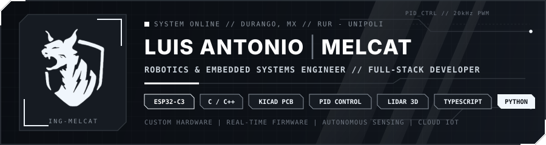
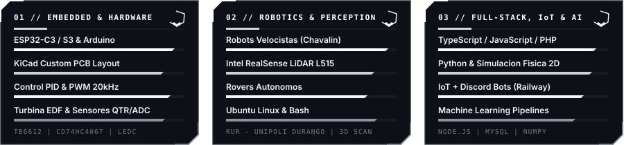

  

   

  

  

    
    
    
  

---

##  PERFIL DE INGENIERIA

Soy **Luis Antonio (`ing-melcat`)**, ingeniero enfocado en **Robotica, Sistemas Embebidos y Desarrollo Full-Stack**, integrante de la **Unidad de Investigacion en Robotica ([RUR](https://rur.unipolidgo.edu.mx/member-1))** en la **Universidad Politecnica de Durango**.

Mi trabajo integra el ciclo completo de hardware y software: desde el diseno esquematico y enrutamiento de PCBs en **KiCad**, programacion de firmware deterministico en **C/C++** sobre microcontroladores **ESP32** y lazos de control **PID** de alta velocidad, hasta simuladores fisicos en **Python**, percepcion 3D con sensores **LiDAR Intel RealSense** en Linux y plataformas web **IoT** conectadas en la nube.

   
  

---

##  ARSENAL TECNOLOGICO & HARDWARE

### Sistemas Embebidos, Robotica y Electronica

  
  
  
  
  
  
  
  

### Desarrollo Full-Stack y Automatizacion

  
  
  
  
  
  
  
  

### Infraestructura, Datos y Simulacion

  
  
  
  
  
  
  

---

##  PROYECTOS DESTACADOS

<table>
  <tr>
    <td width="50%" valign="top">
      <h3>
        
        &nbsp;<a href="https://github.com/ing-melcat/Chavalin">Chavalin — Robot Velocista Pro</a>
      </h3>
      

        <code>ESP32-C3</code> &middot; <code>KiCad PCB</code> &middot; <code>C++</code> &middot; <code>Python Sim</code>
      

      

        Seguidor de linea de competencia con PCB personalizada, multiplexacion de 16 sensores IR QTR-8A (<code>CD74HC4067</code>), compensacion anti-saturacion ADC por registros de hardware, control PWM ultrasonico a 20 kHz (<code>TB6612</code>), turbina EDF de succion, telemetria Web Wi-Fi AP en vivo y simulador fisico 2D en Python.
      

    </td>
    <td width="50%" valign="top">
      <h3>
        
        &nbsp;<a href="https://github.com/ing-melcat/LIDAR-L515-SUPPORT-UBUNTU-24.04-LTS">RealSense LiDAR L515 en Ubuntu 24.04</a>
      </h3>
      

        <code>RealSense L515</code> &middot; <code>Ubuntu 24.04</code> &middot; <code>Shell</code> &middot; <code>C++</code>
      

      

        Documentacion tecnica, parches y scripts de instalacion automatizada para habilitar soporte de camara de profundidad y nube de puntos del sensor LiDAR Intel RealSense L515 sobre kernels modernos de Ubuntu 24.04 LTS.
      

    </td>
  </tr>
  <tr>
    <td width="50%" valign="top">
      <h3>
        
        &nbsp;<a href="https://github.com/ing-melcat/Axis">Axis</a> / <a href="https://github.com/ing-melcat/axis-bot">axis-bot</a> / <a href="https://github.com/ing-melcat/axis-web">axis-web</a>
      </h3>
      

        <code>ESP32</code> &middot; <code>JavaScript</code> &middot; <code>Discord API</code> &middot; <code>Railway</code>
      

      

        Ecosistema IoT de control de asistencia y monitoreo que integra nodos fisicos ESP32 con un bot automatizado en Discord, interfaz web de administracion, exportacion de reportes a Excel y despliegue continuo en la nube.
      

    </td>
    <td width="50%" valign="top">
      <h3>
        
        &nbsp;<a href="https://github.com/ing-melcat/rur_web_v2">RUR Web</a> &amp; <a href="https://github.com/ing-melcat/CitaCiudadana">CitaCiudadana</a>
      </h3>
      

        <code>TypeScript</code> &middot; <code>PHP</code> &middot; <code>JavaScript</code> &middot; <code>MySQL</code>
      

      

        Arquitectura web institucional para la Unidad de Investigacion en Robotica (<a href="https://rur.unipolidgo.edu.mx/member-1">rur.unipolidgo.edu.mx</a>), paneles de visualizacion y plataforma web de gestion de citas ciudadanas.
      

    </td>
  </tr>
</table>

---

##  TELEMETRIA Y ACTIVIDAD EN GITHUB

  

   

  <table>
    <tr>
      <td align="center">
        
      </td>
      <td align="center">
        
      </td>
      <td align="center">
        
      </td>
    </tr>
  </table>

   

  

    

  

---

  
    <strong>ING-MELCAT</strong> &nbsp;|&nbsp;
    Universidad Politecnica de Durango &mdash; <a href="https://rur.unipolidgo.edu.mx/member-1">Research Unit of Robotics (RUR)</a> &nbsp;|&nbsp;
    Durango, Dgo., Mexico
  

